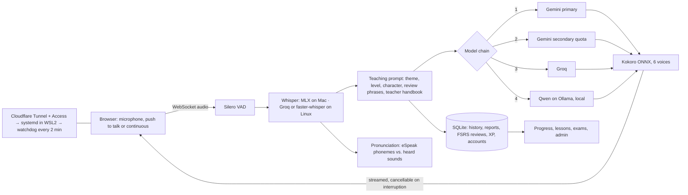

# Voice English Tutor: Case Study

> Spoken English practice in the browser: you talk, the AI talks back, and you can interrupt it mid-sentence. Local speech recognition and synthesis, a four-step fallback chain of language models ending in a local one, six characters, lessons, exams, pronunciation scoring, and spaced review.
> **Source code is private.** This repository documents the project; a live walkthrough is available on request.

**Stack:** Python, Pipecat, FastAPI and WebSockets, Silero VAD, Whisper (MLX on Apple Silicon; Groq or faster-whisper on Linux), Kokoro ONNX text-to-speech, Gemini and Groq APIs with Qwen on Ollama as the local fallback, SQLite, FSRS spaced repetition, eSpeak phonemes for pronunciation scoring, argon2id passwords, Cloudflare Access, vanilla HTML/CSS/JS front end, pytest.

**Status:** personal project, in daily use since October 2026. It runs on my Mac and on a private server of mine behind an identity-aware tunnel, for my own practice and family; not offered to anyone else.

## Problem → Solution

**Problem.** Speaking is the part of a language nobody practices alone. Text chatbots do not train the mouth, and most voice apps either talk over you, wait for you to press a button, or send every word to a paid cloud service. I wanted a conversation partner that listens continuously, stops the moment I start talking, corrects gently without breaking the flow, remembers what I got wrong, and costs nothing per minute.

**Solution.** A browser app connected over a WebSocket to a Pipecat pipeline: voice activity detection decides when I am speaking, Whisper transcribes locally, a language model answers in character, Kokoro speaks the answer, and the whole chain is interruptible. The model behind the conversation is a chain: two free Gemini quotas, then Groq, then a local Qwen on Ollama, so the lesson never stops because a quota ran out. On top of the conversation sit a teaching layer (themes, levels, characters, a "teacher's handbook" prompt), lessons with XP and levels, exams, pronunciation scoring, and spaced review of the phrases I got wrong.

## What I built

- **Interruptible voice loop.** Microphone audio streams to the server; Silero VAD segments speech; Whisper transcribes; the reply is synthesized by Kokoro and streamed back while the model is still writing. Speaking over the AI cancels its speech immediately. An end-to-end test feeds a synthesized sentence through the real pipeline and measures the delay from end of speech to text, to the first word of the reply, and to the first audio.
- **Model fallback chain.** Each utterance tries, in order: Gemini (primary free model), a second Gemini model with its own quota, Groq, and finally Qwen on a local Ollama. Rate limits, quota errors, server errors, and network failures all move the same utterance to the next step; providers without a key are skipped; the interface shows which model answered. Reasoning effort is forced low on the local model so it does not think silently for seconds before speaking.
- **Teaching layer.** Six themes (free talk, work, vacation, restaurant, job interview, travel), three levels that change vocabulary, sentence length, pace, and how much help is given, and six characters with their own voice and manner, including a British one. A teacher's handbook prompt enforces: answer in one to three sentences, always return a question, never stop to correct, reformulate the learner's sentence correctly inside the reply, one correction at a time. The full prompt stays under about 1,000 tokens even with review phrases attached.
- **Help without breaking the flow.** A "help me" button gives escalating hints for the AI's last question: one word, then the start of the sentence, then the whole sentence. Subtitles show both sides, with a tap-to-translate into Portuguese.
- **Reports and spaced review.** Ending a conversation produces a report with a fluency score; each correction becomes a review phrase scheduled with FSRS at 1, 3, 7, and 14 days, and the AI builds a situation where that phrase is needed. A progress screen shows streak days, minutes per week, mastered phrases, and the score curve.
- **Lessons, exams, and XP.** 21 lesson files and 10 scenarios with missions and vocabulary, a placement exam, exam bank and mock exams, levels unlocked by passing an exam, XP for speaking, and per-person achievements without rankings. A dedicated job-interview mode and a "native" mode with faster speech.
- **Pronunciation scoring.** Expected phonemes come from eSpeak; the learner's phrase is compared sound by sound and scored per word, with the typical mistakes of Brazilian speakers (th, final -ed, short versus long vowels, aspirated h, initial r, stress, extra final vowel) explained in Portuguese. Lessons mark each attempt green, orange, or red, and orange passes with half the XP.
- **Child mode.** For a six-year-old: a text-free screen with one big talk button, a picture of the topic, stars for each answer, slow single-level conversations about colors, animals, food, and numbers, no personal data requested, and no audio or transcript stored.
- **Accounts and admin.** On the Mac there is no login; on the network every page, API call, and WebSocket requires a session. Passwords are stored as argon2id hashes, five failures lock the e-mail and the IP for fifteen minutes, cookies are HttpOnly, SameSite strict, and Secure. Cloudflare Access tokens log in automatically for accounts that exist. An admin screen creates learners with one-time passwords, shows minutes, scores, and an audit trail.
- **Private deployment with a watchdog.** The server runs as systemd services inside WSL2 on a Windows machine, behind a Cloudflare Tunnel with Access, hidden from search engines. A scheduled check every two minutes restarts the Linux distribution, the app, Ollama, or the tunnel if any of them is down, at most once per item every ten minutes, and an update screen reports whether a newer release is available.

## Architecture

## Technical challenges

- **Latency and interruption.** A tutor that answers two seconds late or keeps talking over you is unusable. The pipeline streams at every stage (text chunks to speech while the model writes, audio frames to the browser as they are synthesized) and the browser cancels playback the instant the VAD detects the learner's voice. The end-to-end test records the three delays on every run so regressions show up as numbers.
- **Free, but never stuck.** Free tiers run out mid-lesson. The fallback chain treats quota and rate-limit errors as routine, retries the same utterance on the next provider, and always ends in a model that needs no key and no network.
- **Correcting without killing the conversation.** The prompt forbids explicit correction and asks for reformulation inside a natural reply, one issue at a time, plus a question. Review phrases are injected into later conversations so corrections come back as situations, not drills.
- **Speech recognition that admits doubt.** Low-confidence or very short recognitions make the character ask to repeat instead of guessing what was said, and every "didn't catch that" is kept with its audio as a pronunciation signal.
- **Serving a voice app from a home machine.** Microphones need HTTPS, so the Mac path uses a locally generated certificate and the server path a tunnel with identity checks. The Windows host would suspend the Linux side when its keeper task stopped, which is why the watchdog starts with that task and only then the services.

## Scale

- 1,050 commits between October 30 and November 12, 2026
- About 56,800 lines of Python (server about 11,500; teaching layer about 9,400; QA harness about 7,900), 11,600 lines of JavaScript, and 10,700 lines of HTML across 26 screens
- 113 test files with 1,902 test functions
- 6 themes, 6 characters and voices, 3 levels, 21 lessons, 10 scenarios, 12 example conversations
- 73 documents: plans, QA batteries, API notes, deploy runbook, voice licenses

## My role

Sole designer and developer: the audio pipeline and its interruption handling, the model chain, the teaching prompt and the teacher's handbook, lessons, exams, XP and spaced review, pronunciation scoring, child mode, accounts and admin, the QA harness (end-to-end, load, screens, security probes), and the private deployment with its watchdog.

---
Built by **Victor Sestrem** · [LinkedIn](https://www.linkedin.com/in/victor-sestrem/) · victor-sestrem@hotmail.com
